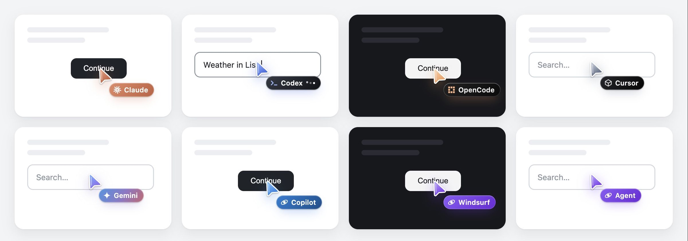
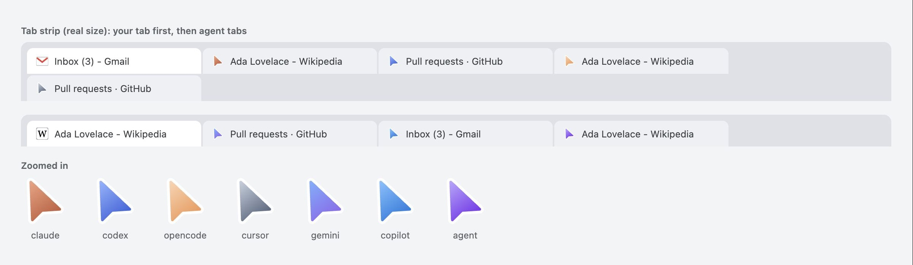

# Tabhand

> Early release, for macOS and Google Chrome.

Let any AI agent (Claude Code, Codex, Cursor, or anything else that speaks MCP) use your real, logged-in Chrome in background tabs. You keep working: Chrome never jumps to the front, and agents never touch your own tabs.

## How it works

```
agent ──stdio──▶ tabhand mcp ──Unix socket──▶ native host ──native messaging──▶ extension ──chrome.debugger──▶ agent's tabs
```

- **Background by default.** Each agent session opens its own tabs with `active: false`, inside a tab group named after the agent. Focus emulation keeps those tabs rendering, so clicks, typing and screenshots work without bringing anything to the front. Agent tabs are muted, and the agent moves on once a page is usable instead of waiting for every video to load.
- **Agents stay in their lane.** The extension only lets a session reach tabs that session opened, plus any tabs and popups those pages open. Your tabs, and other agents' tabs, are invisible to it.
- **Gets along with password managers.** Chrome won't let Tabhand control a page while it shows another extension's frame, such as iCloud Passwords' autofill menu. Tabhand takes those frames out of agent tabs and carries on with the step it was on.
- **No network port.** The bridge talks over a Unix socket in a directory only you can read, with a fresh token each run. Web pages and other machines can't reach it.
- **Nothing sensitive logged, no telemetry.** The bridge logs connect and disconnect events only: no URLs, page content or typed text.
- **You can watch.** While an agent works in a tab, its cursor sits on the page, even across page loads. It glides to whatever the agent clicks, ripples on each click, shows typing dots while it types, waves when you switch to the tab, and fades out once the agent is done. It only animates while you're looking, and it's hidden from the agent's own screenshots.
- **Agent tabs stand out.** While an agent works in a tab, the tab's icon becomes the agent's arrow. The site's own icon comes back when the agent is done.
- **Each agent wears its own colors.** Claude, Codex, OpenCode, Cursor, Gemini and Copilot each get their own cursor and tab group color; anything else gets a violet cursor with its own name. Override with `tabhand mcp --label <name> --theme <theme>`.
- **Stop button.** Click the toolbar icon, or Cancel on Chrome's "started debugging" bar, to pause every agent at once.





## Setup (macOS, Google Chrome)

```sh
npx tabhand setup
```

That's all:

- It installs Tabhand in `~/.tabhand` and connects it to Chrome.
- It adds Tabhand to every agent it finds, for all your projects. Each new session gets the browser tools, and the server's instructions tell the agent when to reach for them.
- It asks before changing anything. Where an agent has its own `mcp add` command, setup uses it. Otherwise it edits the agent's settings file in place, keeping comments, and backs up the original to `~/.tabhand/backups`.
- It walks you through loading the extension in Chrome, which you only do once.

Agents it knows:

- Claude Code, Codex, OpenCode, Cursor, Gemini CLI, Qwen Code, VS Code (Copilot), Copilot CLI, Kiro, Amp, Factory Droid, Warp, Junie, Antigravity
- Devin Desktop (Windsurf), Claude Desktop, Cline, Zed

To add it to only some of them, run `npx tabhand setup --harness claude,codex`.

`tabhand status` checks the install, the Chrome connection and each agent. `tabhand remove` undoes it all. Run `npx tabhand@latest setup` again to update.

Any other MCP client can run `~/.tabhand/bin/tabhand mcp` itself.

### Working on Tabhand

```sh
npm install
node bin/tabhand.mjs setup    # builds dist/tabhand.mjs and installs it from this checkout
node bin/tabhand.mjs reload   # after changing the extension's code
```

Setup copies a single bundled file (`dist/tabhand.mjs`, built by `npm run build`), because macOS doesn't let Chrome's child processes read Documents, Desktop or Downloads. Agents and Chrome both start it through `~/.tabhand/bin/tabhand`. That launcher remembers which Node.js ran setup, since agent apps don't get your shell's PATH. If that Node.js is removed later, it finds another one. If Chrome never connects, the bridge's log at `~/Library/Application Support/tabhand/host.log` says why.

## Tools

| Tool | What it does |
|---|---|
| `browser_open_tab` | Open a background tab in the agent's tab group, optionally loading a URL |
| `browser_navigate` | Load a URL in one of the session's tabs |
| `browser_snapshot` | Read the page as an accessibility outline; actionable elements get refs like `e123` |
| `browser_click` | Click an element by ref |
| `browser_type` | Type into a field, optionally clearing it first and pressing Enter after |
| `browser_press_key` | Press a key or combination such as `Shift+Tab` |
| `browser_scroll` | Scroll up or down |
| `browser_upload_file` | Attach files from your computer to a file field, or through the button that opens a file picker (no system dialog appears) |
| `browser_screenshot` | Screenshot a tab, even in the background |
| `browser_list_tabs` | List the session's tabs |
| `browser_close_tab` | Close one of the session's tabs |

## Tests

- `npm test` runs all of these except the smoke test.
- `node test/setup.mjs` runs setup, status and remove in a throwaway home folder holding existing agent configs. It checks that Tabhand gets added, that comments and other settings survive, that a second run changes nothing, and that the launcher serves the MCP server.
- `node test/package.mjs` packs the npm package, installs the tarball, and runs setup from it.
- `npm run test:e2e` launches a throwaway Chrome for Testing profile, runs two agents in parallel, and checks they can't reach each other's tabs and that the browser never comes to the front.
- `node test/new-tabs.mjs` checks that links, `window.open()` and popups from an agent's tab never take over your tab, and that the agent gets the new tab.
- `node test/upload.mjs` checks that files reach a page byte for byte, through a file field or a button's file picker, including files over Chrome's 1 MB message cap.
- `node test/foreign-frames.mjs` checks that an agent gets through pages where a password manager's autofill menu pops up, using a stand-in extension.
- `npm run test:smoke` runs a short check against the Chrome you have open.
- `node test/cursor-presence.mjs` checks the cursor and tab badge show before the first action, survive page loads, and leave when the agent is done.
- `node test/load-speed.mjs [--real]` compares how long the agent waits for pages with a plain tab.
- `node test/cursor-gallery.mjs` renders every cursor theme side by side, and `node test/badge-preview.mjs` every tab badge.

## Roadmap

- Per-site approval: agents ask before using a site for the first time
- Confirmation before sending, buying or deleting
- Logins filled from your password manager without the AI seeing the password
- Downloads, dialogs and iframes
- Windows and Linux, Chrome Web Store listing

## License

MIT
